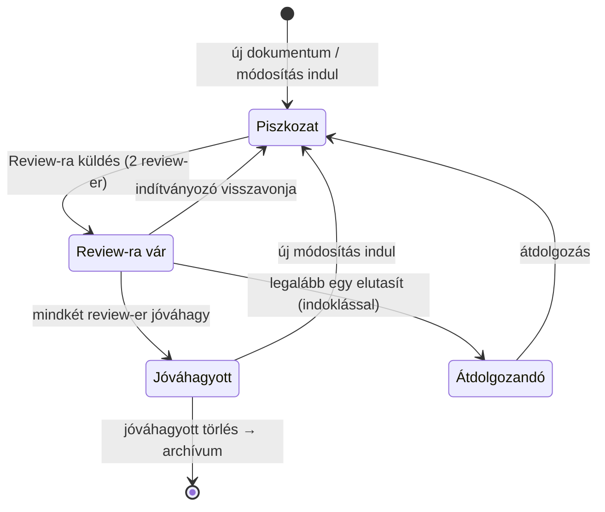

---
tags:
  - taltos/egyseg
allapot: prototípusban
mvp: 6
---

# Státusz-workflow

## Cél

A dokumentum érettsége látható legyen: piszkozat → átnézés alatt → tesztelt → publikált.

> [!success] Döntve — D45 (Döntési napló v10, 2026-10-23)
> Az alábbi review-folyamat váltja a négy státuszt (`draft`, `review`, `tesztelt`, `publikált`) és a D32 Jóváhagyó-szerephez kötött jóváhagyását. A lenti „Működés a prototípusban” a korábbi modellt írja le. A szerepek: [[Felhasználók/Szerepkörök|Szerepkörök]].

## Review-folyamat (2026-10-23)

### Mire vonatkozik

Minden tartalmi változásra, amelyet egy színtér-tag indítványoz:

- **új dokumentum** létrehozása vagy **új fájl feltöltése** (lásd [[Adattárolás/Többformátumú tartalom és verziókövetés|Többformátumú tartalom]]),
- meglévő dokumentum **tartalmának módosítása** vagy **új verzió feltöltése**,
- **dokumentumfrissítés:** metaadat-változás (cím, fajta, címkék, kapcsolatok),
- **bármilyen törlés:** dokumentum archiválása, csomagon belüli fájl eltávolítása.

Nem tartozik ide: kommentek (D20, a szerzőjük kezeli), kedvencek, követés, a „Még aktuális” megerősítés (D33, mert nem változtat a tartalmon; bármely színtér-tag megteheti), tagság- és szerepkezelés.

### Állapotok

| Állapot | Jelentés | Ki látja |
|---|---|---|
| **Piszkozat** | szerkesztés alatt, még nincs review-ra küldve; közösen szerkeszthető (D29) | a színtér tagjai |
| **Review-ra vár** | beküldve, a két review-er döntésére vár; a tartalom **befagyott** | a színtér tagjai |
| **Átdolgozandó** | legalább egy review-er elutasította, indoklással | a színtér tagjai |
| **Jóváhagyott** | mindkét review-er jóváhagyta; ez a végleges állapot | a színtér tagjai; az MCP (D38) csak ezt adja ki |



### Szabályok

- **Két review-er, egyhangú jóváhagyás.** Az indítványozó a Review-ra küldéskor két különböző színtér-tagot jelöl meg, saját magán kívül. A piszkozat közreműködői is lehetnek review-erek. Csak a két jóváhagyás együtt véglegesít.
- **Elakadt review:** az indítványozó vagy a Színtérgazda kicserélheti a review-ert (`reviewer_replaced`); helyette dönteni senki nem dönthet. A függő review-k a napi összefoglalóban emlékeztetnek.
- **Változásleírás:** mindig opcionális.
- **Verziószám:** az `iteration` a Jóváhagyott változások száma (v1, v2 …).
- **Egy elutasítás elég.** Ilyenkor az anyag Átdolgozandó lesz, és a másik review-er függő döntése megszűnik. Az elutasítás **csak indoklással** menthető: az indoklás a `review_rejected` esemény részleteiben tárolódik, és **kommentként jelenik meg az eseményfolyamban** ([[Kollaboráció/Kommentek|Kommentek]]).
- **Befagyott tartalom.** Review-ra várás alatt a változat nem szerkeszthető. Módosítani csak visszavonás (`review_withdrawn`) után lehet, és az új beküldés új review-t indít.
- **Újrabeküldés Átdolgozandóból:** alapból ugyanaz a két review-er kapja meg, de az indítványozó cserélheti őket.
- **Egyszerre egy nyitott változás dokumentumonként.** Amíg egy változás Review-ra vár, ugyanarra a dokumentumra nem küldhető be másik.
- **Mit lát az alapnézet:** mindig **a legutóbbi változatot** (a függő változatot is), állapotjelvénnyel. A legutóbbi Jóváhagyott állapot a [[Dokumentumok/Verziózás|Verziók]] fülön érhető el, és a review-nézet ehhez képest mutat diffet.
- **Törlés:** a törlési kérés is Review-ra vár. Jóváhagyás után a dokumentum archívumba kerül (soft delete, D8, D20). Kivétel: egy **soha be nem küldött piszkozatot** az indítványozó review nélkül eldobhat, mert még nincs véglegesített tartalom.
- **Visszaállítás régi verzióra** (Verziózás): új változásként indul, ugyanígy két review-errel.
- **Értesítések (D35, D46):** a megjelölt review-erek azonnali értesítést kapnak a kérésről (alkalmazáson belül és e-mailben), és a kérés a [[Nyomonkövetés/Feladat-dashboard|dashboardjukon]] jelenik meg. Az indítványozó értesítést kap minden döntésről és a végeredményről. A függő review-k a napi összefoglalóban emlékeztetnek.

### Közös szerkesztés és review (D29)

A szerkesztés a Piszkozat állapotban folyik, akár többen egyszerre. A D29 folyamatos perzisztálása és a revízió-checkpointok változatlanok, de nem véglegesítenek: csak a Review-ra küldés hoz létre review-kérést. **Az indítványozó az, aki beküld.** A közreműködők listája (`contributors`) a kéréshez csatolódik.

### Adatmodell (vázlat)

```sql
CREATE TABLE change_requests (
  id                    uuid PRIMARY KEY,
  document_id           uuid NOT NULL REFERENCES documents(id),
  kind                  text NOT NULL,   -- 'create' | 'update' | 'metadata' | 'delete'
  base_revision_id      uuid REFERENCES document_revisions(id),  -- utolsó Jóváhagyott
  proposed_revision_id  uuid REFERENCES document_revisions(id),  -- törlésnél NULL
  initiator_id          uuid NOT NULL REFERENCES users(id),
  state                 text NOT NULL,   -- 'pending' | 'approved' | 'rejected' | 'withdrawn'
  created_at timestamptz NOT NULL DEFAULT now(),
  decided_at timestamptz
);
-- dokumentumonként legfeljebb egy függő kérés
CREATE UNIQUE INDEX one_pending_per_doc ON change_requests(document_id) WHERE state = 'pending';

CREATE TABLE change_request_reviewers (
  change_request_id uuid NOT NULL REFERENCES change_requests(id),
  reviewer_id       uuid NOT NULL REFERENCES users(id),
  decision          text,                -- NULL | 'approved' | 'rejected'
  reason            text,                -- elutasításnál kötelező
  decided_at        timestamptz,
  PRIMARY KEY (change_request_id, reviewer_id),
  CHECK (decision <> 'rejected' OR reason IS NOT NULL)
);
```

- A dokumentum megjelenített állapota a legutóbbi kérésből és a piszkozatból **származtatott érték**. A `documents` táblán gyorsítótárként egy `review_state` oszlop tárolhatja, amely tranzakcióban frissül.
- `documents.approved_revision_id` mutat a legutóbbi Jóváhagyott revízióra. Ezt használja az MCP, az export és a „Jóváhagyott” szűrő.
- **A döntés tranzakciója:** a review-er döntése, a kérés lezárása és a `documents` frissítése (jóváhagyáskor `approved_revision_id`, törléskor `deleted_at`) egyetlen ACID-tranzakció. A második jóváhagyás versenyhelyzetét sorzárolás (`SELECT … FOR UPDATE` a kérésen) kezeli.
- **Események:** `review_requested`, `review_approved`, `review_rejected` (indoklással, kommentként vetítve), `review_withdrawn`, `change_approved`, `change_rejected`, `reviewer_replaced`.

## Működés a prototípusban

Négy státusz: `draft`, `review`, `tesztelt`, `publikált`. A váltás bárkinek szabad, és `status_changed` eseményt naplóz. Státuszra szűrni lehet.

## Kapcsolódó döntések

[[Tervezés/Tervezés (hetedik kör)/tudasbazis-architektura-dontesi-naplo|Döntési napló v10]] — **D45** (review-folyamat, felülírja a D32-t), D33, D46. Korábbi: D6, D32.

## Nyitott kérdések

- ~~Ki hagyhat jóvá?~~ **Döntve (D45):** a változásonként megjelölt két review-er, a színtér tagjai közül, az indítványozón kívül.
- ~~Új mentés egy publikált dokumentumon?~~ **Felülírva (D45):** a szerkesztés Piszkozatban folyik, az alapnézet a függő változatot mutatja, az MCP és az export a legutóbbi Jóváhagyott revíziót adja.
- ~~Kötelező indoklás az elutasításhoz?~~ **Döntve (V22, D45):** igen, kommentként jelenik meg az eseményfolyamban.
- **Kivétel (V53, D45):** ha egy másik dokumentum tulajdonosa a rá mutató `helyettesíti` kapcsolatot törli ([[Dokumentumok/Kapcsolatok|Kapcsolatok]], V50), az rendszer-revízió, review nélkül.
- Nincs nyitott kérdés.

## Kapcsolódó egységek

[[Felhasználók/Jogosultságok|Jogosultságok]] · [[Nyomonkövetés/Értesítések|Értesítések]] · [[Dokumentumok/Verziózás|Verziózás]]
